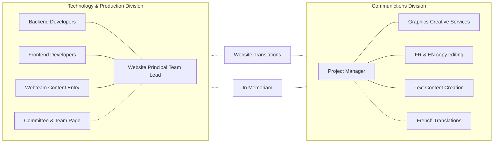
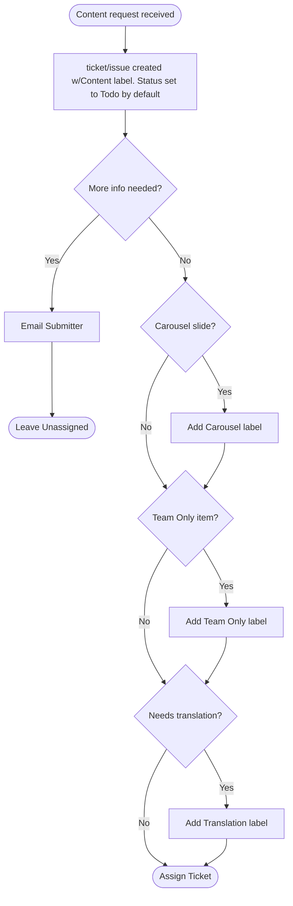

# Montréal 2027 Content Entry and Translation Standard Operating Procedures <!-- omit in toc -->

## Table of Contents <!-- omit in toc -->
- [Introduction](#introduction)
- [Contributing](#contributing)
- [Team Structure](#team-structure)
- [Managing Content Requests](#managing-content-requests)
  - [Content Intake Flow](#content-intake-flow)
- [Tickets](#tickets)
  - [Ticket statuses](#ticket-statuses)
  - [Ticket Labels](#ticket-labels)
- [Content Entry](#content-entry)
  - [Workspaces](#workspaces)
  - [Workflow](#workflow)

## Introduction

Welcome, and thank you for your interest in contributing to the Montréal 2027 website project. We are always interested in speaking with individuals that want to help out entering content.

The site is built using Drupal with a custom theme, and uses specialized modules for convention management, including a team contact form.

**_Note:_** The terms _**issue**_ and _**ticket**_ are used interchangeably. _**Issue**_ is used when describing menu items or tabs on GitHub, while _**ticket**_ is used in casual conversation.

## Contributing

All prospective contributors must contact the [Web Team Leadership](mailto:website@montreal2027.ca) and wait for guidance before proceeding.

After emailing the Web Team, we will schedule a brief 15 to 30 minute call with a member of the team leadership to discuss your experience and how it would best fit in with our needs. After the call, if we decide to proceed, the next steps are:

- [ ] Fill out the volunteer form, indicating that you have talked with the Area Head. Detailed instructions will be provided
- [ ] Go to [the membership portal](https://reg.montreal2027.ca), create an account, and agree to the Code of Conduct. You are not required to purchase a membership
- [ ] Once the previous step has been completed, the Area Head will fill out the Onboarding Request Form, asking for you to be assigned to the Web Team
- [ ] After the Onboarding Request Form has been submitted, it will typically take 48 hours for the request to be processed. Once processed, you will receive an email to your personal email address with instructions on how to activate your Montréal 2027 email
- [ ] Once you have been onboarded and you have setup your Montréal 2027 email, you will be asked to go to [Github](https://github.com) and create an account using your new email address, even if you already have a Github account. Send your Github username to the Area Head so you can be invited to the Web Team on Github. When you receive the email with the invitation, click on the link to accept the invitation, which will give you access to the site project used to manage content requests.

## Team Structure

[Stand-alone diagram](STRUCTURE.md)

## Managing Content Requests

All content entry and maintenance requests will have an ticket created in [GitHub](https://github.com/orgs/Montreal-2027/projects/2). If you are not familiar with how GitHub issue tracking works, reach out to an experienced Web Team member, and we'll schedule some training to show you how to use it. 

### Content Intake Flow

[Stand-alone diagram](INTAKE.md)

## Tickets

### Ticket statuses
The Content Project has the following statuses:

| Status | Description |
|---|---|
| `Todo` | This is the default status. The ticket has just been created, and has not been started|
| `In Progress` | This ticket has been started and is actively being worked on |
| `Ready to deploy` | All content for this ticket has been completed. English and French language content are two distinct but related tickets |
| `Done` | The completed ticket has successfully been deployed to the production server |
| `On Hold` | A ticket that has been `In Progress`, but had to be stopped for some reason. Should rarely be used for content |
| `Info Needed` | Questions or concerns about the content request have been sent to the submitter and we are waiting for a response |
| `Won't Fix/Superseded` | Also rarely used for content, but an occasional ticket my have a new one created that supersedes a previous ticket |

### Ticket Labels
Ticket labels are used to show at a glance what kind of work needs to be done for that ticket. 

| Label | Description |
|---|---|
| `Carousel` | A slide to be added, changed, or deleted from a carousel |
| `Content` | Add, change, or delete content in either language |
| `Deploy` | A task required for an upcoming deploy |
| `Team Only` | Items for the Team Only area of the website |
| `Translation` | Requests for content translation |

The following labels are only to be used for technical ticket/issues and should not be used for content tickets.

| Label | Description |
|---|---|
| `Bug` | A problem with the function of the site.  **Do Not** use this for ticket/issues with the content, such as typos, misspellings, or missing content |
| `Configuration` | Configuration changes needing to be made to the site |
| `CSS` | CSS/Layout only additions, changes, or deletions |
| `Enhancement` | A request to enhance an existing feature of the site |
| `Feature Request` | A request for a new feature |
| `Security Update` | Mitigation for security issues |
| `Template` | Twig template creation, modification or deletion |
| `Upgrades` | Contrib modules & themes or Drupal Core that need to be updated |

## Content Entry

This applies to content entry and translations. We're a small team for a large, international convention, so any member of the Web Team may be asked to assist with content entry. If you have not received training on how to enter and update content, reach out to the Web Team leadership to schedule training. This site uses features that are not common to Drupal websites that require familiarization. This applies to both English and French content, taxonomy, menus, and user interface/configuration translations. All content tickets will have a sub-issue created for the French translation. Any and all ticket comments related to that translation should be done in the sub-issue.

### Workspaces
We use a Drupal module that creates isolated workspaces within the main website. These workspaces allow for content to be safely added, edited, or deleted, without any risk to the main website. This will allow committee and team members with the same access you have, to preview the changes to the website, while eliminating the need to then copy the content from one location to another. There are three primary workspaces

|Name|Purpose|
|---|---|
| **Live** | This is the current website that the general public will see |
| **Staging** | This is the primary workspace for content entry |
| **Hotfix** | This workspace is reserved for adding, editing, or deleting content between scheduled releases |

Just prior to a release, the `staging` or `hotfix` workspace will be reviewed, and once approved, the changes will be published during the release window.

*Translation note: User interface and some other translations require you to submit them while working in the **Live** workspace. When you submit, a notice will be displayed and you will have the option to submit your changes in **Live** or cancel. It is permitted to choose to submit your changes in **Live** if you are confident of the translation. It is also permitted to add these translations directly in the **Live** workspace in the future.*

### Workflow

1. Login to the [GitHub Project](https://github.com/Montreal-2027/projects/2).
2. Change the status of the ticket from `Todo` to `In Progress`.
3. Login to the [Montreal 2027](https://montreal2027.ca/user/login/google) website.
4. Switch to the `Staging` workspace. For a hotfix, use the `Hotfix` workspace.
5. Add, edit, or delete [content](https://montreal2027.ca/admin/content).
6. Proofread your work.  Ideally, ask someone else to proofread your work.
7. Until the scheduled release, you may come back to the workspace and revise your work. After switching to the workspace, from the same menu, you may click on `Manage workspace` to see all content that has currently been revised or added in the workspace.
8. After the the English language content has been added, add a comment to the ticket documenting that the task has been completed, and change the status to `Ready to deploy`. Be sure to tag the Translation Team leader in the comment using `@c-maltais`.
9. During the release window, the Area Head or other authorized team member will publish the content revisions and additions.
